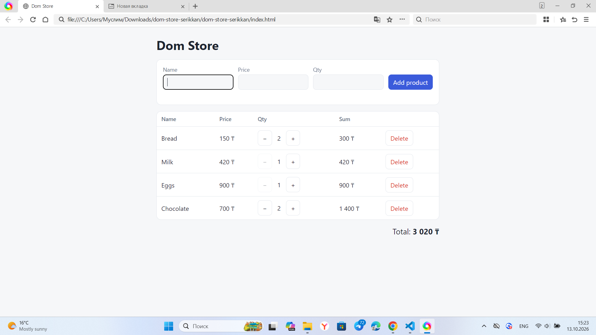

# dom-store-serikkan

Lab 5 (IT1-2310): DOM, events, forms. An interactive product list built on my `Store` class from Lab 4 (`{ name, price, qty }`). Pure JavaScript and the DOM API, no frameworks.

## How to open

Open `index.html` in a browser (double-click is enough, no build and no server needed).

## What it does

- Renders the product list from `Store` into a table.
- "Add product" form with validation: empty name, duplicate name, price <= 0 or not a number, qty not a whole number. Errors are shown next to the field, not with `alert`.
- Buttons to delete a product and to change its quantity (+ / -).
- Live total: recalculated after every change, no page reload.

## Events I handled and why

I handled three events. The `submit` event on the form adds a new product, and I call `preventDefault()` so the page does not reload before the data is checked. For the delete, plus and minus buttons I added only one `click` listener to the whole list, because the rows are drawn again after every change and one listener on the parent keeps working for all of them. Inside it I use `event.target.closest()` to find which button was pressed and which product it belongs to. The `input` event removes the error message as soon as the user starts typing in the field again.

## Screenshot

## AI tools used

Claude (Anthropic) helped me write the first version of the code. I read and checked it and can explain it at the defense.
